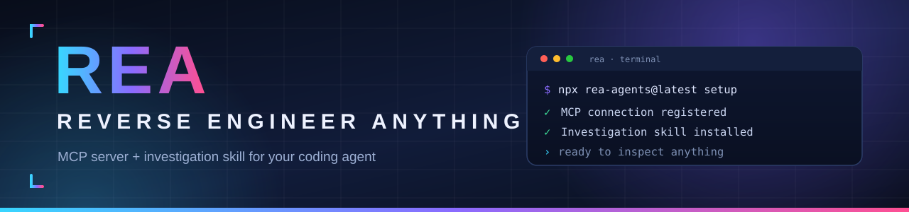

<p align="center">
  
</p>

# Reverse Engineering Agent — Полное руководство по установке

> **Языки:**  [English](../README.md) (main / authoritative) ·  [简体中文](README.zh-CN.md) ·  [繁體中文](README.zh-TW.md) ·  [日本語](README.ja.md) ·  [한국어](README.ko.md) ·  [Türkçe](README.tr.md) ·  [Русский](README.ru.md) ·  [Tiếng Việt](README.vi.md) ·  [ไทย](README.th.md) ·  [Deutsch](README.de.md) ·  [Español](README.es.md) ·  [Français](README.fr.md) ·  [Українська](README.uk.md) ·  [Polski](README.pl.md) ·  [Português (Brasil)](README.pt-BR.md) ·  [العربية](README.ar.md) ·  [فارسی](README.fa.md) ·  [اردو](README.ur.md) ·  [Bahasa Indonesia](README.id.md) ·  [Italiano](README.it.md) ·  [Ελληνικά](README.el.md) ·  [മലയാളം](README.ml.md) ·  [தமிழ்](README.ta.md) ·  [Română](README.ro.md) ·  [Български](README.bg.md) ·  [বাংলা](README.bn.md) ·  [हिन्दी](README.hi.md)
>
> ℹ️ Этот перевод соответствует английскому мастеру. При расхождениях **главенствует английский**. Блоки кода, пути и команды никогда не переводятся.

> **REA — Reverse Engineer Anything**
> Сервер MCP (Model Context Protocol) + навык расследования: даёт вашему агенту кодинга инструменты для изучения ПО — нативные бинарники, JavaScript/Electron-приложения, браузеры, .NET, Android, прошивки и не только.

- **Официальный сайт:** https://rea.tools/
- **Официальный исходный код:** https://github.com/morluto/rea
- **npm-пакет:** `rea-agents`
- **Лицензия:** MIT (сам REA). Сторонние средства анализа имеют собственные лицензии.
- **📚 [PLATFORM-GUIDE.md](../PLATFORM-GUIDE.md)** (на английском) — пошаговая настройка для каждой платформы (сначала Windows: Electron, Web, .NET, Android, WASM, Native/Ghidra, WSL2) с разбором ошибок
- **🆓 [FREE-AGENTS.md](../FREE-AGENTS.md)** — полностью бесплатные coding-агенты для REA (OpenCode с бесплатными моделями, локальный Ollama, Gemini CLI, Qwen Code). REA — это MCP-сервер, а не AI-модель.
- **📦 Включён офлайн-бэкап** — неофициальное зеркало официального репозитория + npm-tarball; только на случай исчезновения официальных источников. См. **[Раздел 20 — Офлайн-бэкап / зеркало (неофициальное)](#20-офлайн-бэкап--зеркало-неофициальное)**.

> ⚠️ **Важно:** Загружайте REA только с `morluto/rea`, `rea.tools` или npm-пакета `rea-agents`. Похожие названия репозиториев не подтверждают официальную сборку.

---

## Содержание

1. Что такое REA (и чем она не является)
2. Законное и ответственное использование
3. Что можно анализировать
4. Системные требования
5. Шаг 1 — Подготовка компьютера
6. Шаг 2 — Выбор агента кодинга
7. Шаг 3 — Подключение REA
8. Шаг 4 — Проверка установки
9. Шаг 5 — Первое расследование (пример Notes)
10. Нативный анализ (бинарники / EXE / DLL)
11. JavaScript & Electron-приложения
12. Наблюдение за браузером
13. Прочие цели и требуемые инструменты
14. Создание RL-окружений
15. REA из терминала (CLI)
16. Обновление или удаление REA
17. Устранение неполадок
18. Данные, конфиденциальность и безопасность
19. Шпаргалка-чеклист
20. Офлайн-бэкап / зеркало (неофициальное)

---

## 1. Что такое REA (и чем она не является)

**REA — это:**
- Локальный MCP-сервер + навык агента, который позволяет **агенту кодинга** изучать ПО, которое у вас есть локально.
- Возвращает **улики**: ассемблер, псевдокод, карты модулей, пары IPC-каналов, захваченный сетевой трафик, расположение исходников — не оригинальный код.
- Анализ выполняется **на вашей машине**. Ваше приложение не загружается REA; провайдер модели агента видит результаты (см. [Данные и конфиденциальность](#18-данные-конфиденциальность-и-безопасность)).

**REA — это не:**
- Волшебная кнопка «превратить в исходный код». Результаты — ассемблер/псевдокод и ссылки; агент объясняет и помогает воссоздать поведение.
- Инструмент для взлома лицензий/DRM или обхода платной активации. Не используйте REA для этого.
- Обход обфускации. Сильно упакованные цели (VMProtect, Themida, анти-тампер) — крайне трудны.
- Доступ к серверной стороне. Сервер за API изучить нельзя; видна только клиентская/сетевая сторона.

---

## 2. Законное и ответственное использование

Реверс-инжиниринг может быть законным для интероперабельности, исследований безопасности, отладки и анализа ПО, которым вы **владеете** — но законы и лицензии различаются по юрисдикциям.

**Следует:**
- Анализировать ПО, которым вы владеете, на которое у вас есть лицензия или разрешение на изучение.
- Уважать лицензионные соглашения, Условия использования и анти-circumvention-нормы DMCA.
- Использовать результаты для интероперабельности, образования и защитной безопасности.

**Не следует:**
- Обходить DRM, активацию лицензий или защиту от копирования.
- Распространять взломанный/утёкший код проприетарного ПО.
- Анализировать цели, на которые у вас нет прав.

Это руководство не является юридической консультацией. В сомнениях — обратитесь к юристу.

---

## 3. Что можно анализировать

| Цель | Что возвращает REA | Нужен нативный движок? |
|---|---|---|
| Нативные бинарники / библиотеки (EXE, DLL, ELF, Mach-O) | Функции, ассемблер, псевдокод, вызывающие, xrefs, константы | Да — Hopper, Ghidra или IDA |
| JavaScript & Electron-приложения | Модули, импорты, IPC-каналы + обработчики, расположение исходников | Нет |
| Страницы браузера (runtime) | Запросы/ответы, скрипты, формы JSON, окно наблюдения | Браузер на движке Chrome |
| .NET-сборки / Flutter / пакеты | Инспекция модулей и ресурсов | Нет |
| Android APK / устройства / ресурсы | Декомпилированные классы, ресурсы, взаимодействие с устройством | JADX / adb / Apktool |
| Прошивки | Извлечённые файловые системы/блобы | Binwalk / Unblob (Linux) |
| WASM | Инспекция модулей и функций | WABT |
| Базы SQLite | Инспекция схемы и запросов | Node.js 24.15+ / 26+ |
| EVM-байткод | Структура контракта | Node.js (Linux x64) |
| Захваты HAR / SAZ / mitmproxy | Разобранные улики трафика | Node.js / mitmdump |
| PCAP / PCAPNG | Факты о пакетах/протоколах | TShark / capinfos (Linux) |

---

## 4. Системные требования

**Минимум:**
- Node.js **22.23.4+**, **24.22.1+** или **26+ (>= 26.12.1)** (npm включён)
- Поддерживаемый агент кодинга (шаг 2)
- Рабочий каталог для расследований

**Для нативного (бинарного) анализа** — один из:
- **Ghidra 12.1.x** + 64-битный **JDK 21+** (бесплатно, рекомендуется на Windows)
- **IDA** (коммерческая; проверенные профили Windows legacy GUI + headless supervisor)
- **Hopper** (коммерческая; macOS и часть Linux — **на Windows недоступна**)

**Заметки об ОС:**
- Windows: используйте **PowerShell**; пути с пробелами — в кавычках. Если агент работает в WSL, ставьте Node.js + REA **внутри** WSL и используйте Linux-пути.
- Linux: `ps` из `procps` должен быть в `PATH` для запуска Ghidra/JADX/прошивок и статического анализа.
- macOS: Terminal; некоторые шаги требуют Xcode Command Line Tools (сборка декомпилятора Ghidra на arm64).

---

## 5. Шаг 1 — Подготовка компьютера

### 5.1 Проверьте Node.js

```powershell
node -v
npm -v
```

Ожидается: `v22.23.4+`, `v24.22.1+` или `v26.12.1+`. Старше → установите Node.js 24 LTS.

### 5.2 Установка Node.js на Windows (если нет)

```powershell
winget install --exact --id OpenJS.NodeJS.LTS
```

Введите `Y` при запросе согласия, закройте и снова откройте PowerShell, проверьте `node -v`. (Запасной вариант: установщик с https://nodejs.org/.)

> **Особенность PowerShell:** если `npx` падает с "running scripts is disabled on this system", используйте `npx.cmd` и `npm.cmd`:
> ```powershell
> npx.cmd rea-agents@latest setup
> ```

### 5.3 (macOS)

Скачайте `.pkg` Node.js 24 LTS или через Homebrew: `brew install node`.

### 5.4 (Linux)

```bash
sudo apt install curl unzip          # Debian/Ubuntu
curl -fsSL https://fnm.vercel.app/install | bash
# переоткройте shell, затем:
fnm install 24 && fnm use 24 && fnm default 24
```

### 5.5 Создайте рабочую папку

```powershell
mkdir rea-work
cd rea-work
```

---

## 6. Шаг 2 — Выбор агента кодинга

REA поддерживает любой агент с локальным **MCP**. Выберите один — все примеры ниже используют **setup ID** клиента (`--client <id>`).

| Клиент | Setup ID | Установка / заметки |
|---|---|---|
| Claude Code | `claude_code` | `irm https://claude.ai/install.ps1 \| iex` (Win) · `curl -fsSL https://claude.ai/install.sh \| bash` (macOS/Linux) |
| Claude Desktop | `claude_desktop` | Установите и войдите, затем `npx rea-agents@latest setup --client claude_desktop` |
| Codex | `codex` | `npm i -g @openai/codex` или скрипт установки · вход через ChatGPT |
| Cursor | `cursor` | Установите редактор, откройте рабочую папку, режим Agent |
| Windsurf | `windsurf` | Та же схема; чат агента |
| VS Code | `vscode` | Сначала настройте GitHub Copilot, затем режим Agent |
| OpenCode | `opencode` | `npm install --global opencode-ai`, запустите `opencode`, `/connect` для модели, затем `--client opencode` |
| Gemini CLI | `gemini_cli` | |
| Devin | `devin` | |
| GitHub Copilot CLI | `copilot_cli` | |
| Antigravity | `antigravity` | |
| Qwen Code | `qwen_code` | |
| Kimi Code | `kimi` | |
| Grok Build | `grok_build` | |
| Command Code | `commandcode` | |
| OMP | `omp` | |
| Pi | `pi` | |
| Hermes | `hermes` | |
| Qoder | `qoder` | |
| Factory Droid | `droid` | (npm ≥ 6.5.0) |
| Trae | `trae` | (npm ≥ 6.5.0) |
| WorkBuddy | `workbuddy` | (npm ≥ 6.5.0) |
| ZCode | `zcode` | (npm ≥ 6.5.0) |
| DeepSeek Harness | `dsh` | (npm ≥ 6.5.0) |
| FreeBuff | `freebuff` | (npm ≥ 6.8.0) |

**Grok Bot:** в чате бота попросите добавить на его хост-компьютере сервер MCP с именем `rea`:
```
npx -y rea-agents@6.4.0 mcp
```

---

## 7. Шаг 3 — Подключение REA

### Вариант A — Через агента (рекомендуется)

Вставьте в чат агента:

```
Install REA and connect it to this coding agent using npx rea-agents@latest setup.
Show me the setup plan for approval, then verify the installation.
```

Агент выполнит setup, покажет план и применит его после вашего одобрения.

### Вариант B — Запустите setup сами

```powershell
npx rea-agents@latest setup
```

Для конкретного клиента:

```powershell
npx rea-agents@latest setup --client opencode
```

Во время setup:
- **Стрелки** — перемещение, **Space** — выбор клиента, **Enter** — продолжить.
- REA добавит **MCP-подключение** + **навык расследования** и **создаст резервную копию** существующей конфигурации до изменений.
- Изменения применяются только после вашего одобрения.
- Для первого упражнения необязательную установку Hopper можно пропустить.

### Перезапустите клиент после setup

- Десктопные приложения (Claude Desktop, Cursor, Windsurf, VS Code): **полностью закройте** и откройте снова (Windows: также через значок в трее).
- Терминальные агенты (Claude Code, Codex, Gemini CLI, OpenCode): завершите и запустите снова.

---

## 8. Шаг 4 — Проверка установки

Запустите проверку doctor для вашего клиента (замените `<client_id>`):

```powershell
npx -y rea-agents@latest doctor --client opencode --json
```

Исправный отчёт показывает `"healthy": true`. Затем спросите агента:

```
Check that REA is connected and show me which REA tools you can use.
```

---

## 9. Шаг 5 — Первое расследование (пример Notes)

Официальный пример — маленькое Electron-приложение с кнопкой **Export notes**. Устанавливать Electron не нужно — агент читает код.

Вставьте агенту:

```
Download https://rea.tools/examples/notes-example.zip into a new example
folder and unpack it. Use REA to find what happens when I click Export notes.
Show where notes.csv is written, which fields it contains, and the relevant
files and lines.
```

Ожидаемый результат: клик Export отправляет IPC-сообщение `notes:export`; главный процесс форматирует заметки в CSV и записывает `notes.csv` (колонки: `id`, `title`) в папку «Загрузки».

Ручной анализ из терминала:

```powershell
npx -y rea-agents@latest analyze-javascript-application "C:\path\to\notes-example" --json
```

---

## 10. Нативный анализ (бинарники / EXE / DLL)

Глубокий нативный анализ требует провайдера. На **Windows** используйте **Ghidra** или **IDA** (Hopper недоступна на Windows).

### 10.1 Ghidra (бесплатно) — настройка на Windows

1. Установите **64-битный JDK 21+** (с компилятором). Проверка:
   ```powershell
   java -XshowSettings:properties -version
   javac -version
   ```
2. Скачайте **Ghidra 12.1.4** из списка *Assets* релиза и распакуйте `ghidra_…_PUBLIC_….zip` (именно архив релиза, **не** "Source code").
3. Запомните папку с `ghidraRun.bat` — это ваш `GHIDRA_INSTALL_DIR`.
4. В PowerShell:
   ```powershell
   $env:GHIDRA_INSTALL_DIR = "C:/tools/ghidra_12.1.4_PUBLIC"
   $env:JAVA_HOME = "C:/tools/jdk-21"   # папка из java.home
   npx -y rea-agents@latest doctor --provider ghidra --json
   npx rea-agents@latest setup
   ```
   Замените пути своими. Проверьте обновлённый план setup, одобрите и **перезапустите агента**.

> Поддержка Ghidra на Windows — **экспериментальная, только чтение**, для нативных x86/x64 PE на локальных **NTFS** дисках.

### 10.2 Ghidra — macOS / Linux

```bash
export GHIDRA_INSTALL_DIR="/absolute/path/to/ghidra_12.1.4_PUBLIC"
export JAVA_HOME="/absolute/path/to/jdk-21"
npx -y rea-agents@latest doctor --provider ghidra --json
npx rea-agents@latest setup
```

На macOS arm64 и Linux arm64 сначала соберите нативный декомпилятор Ghidra (на macOS нужны Xcode Command Line Tools, make, bison).

### 10.3 IDA

1. Установите и настройте upstream IDA MCP согласно руководству провайдера IDA.
2. Сохраните рабочую регистрацию как `ida-mcp.json`. Пример (headless supervisor с `idb_open`/`idb_list`/`idb_close`):
   ```json
   {
     "command": "idalib-mcp",
     "args": ["--stdio", "--max-workers", "1"],
     "mode": "headless"
   }
   ```
   Для подключённого легаси-GUI 1.4.0 скопируйте его рабочие command/args/env (сначала откройте бинарник в IDA и запустите плагин).
3. Подключите:
   ```powershell
   $env:REA_IDA_MCP_CONFIG = "C:/analysis/ida-mcp.json"
   $env:REA_ANALYSIS_PROVIDER = "ida"
   npx -y rea-agents@latest doctor --provider ida --json
   npx rea-agents@latest setup
   ```
   На macOS/Linux используйте `export` вместо `$env:`. После setup перезапустите агента.

> Проверенные профили IDA: Windows legacy GUI и headless supervisor, macOS arm64 headless supervisor (IDA Professional 9.1). npm 6.4.0 не включает macOS headless-профиль / нативный GUI-мост — им нужна сборка REA из исходников.

### 10.4 Hopper (только macOS / Linux)

Setup может обнаружить существующий Hopper или предложить план установки. На macOS при первом запуске выберите демо-режим или активируйте лицензию. Автоматическая установка на Linux требует x86_64 и Ubuntu 24.04+, Fedora 41+, Nobara 44+, Arch, CachyOS или Omarchy. На Linux arm64 используйте Ghidra.

```bash
npx -y rea-agents@latest doctor --provider hopper --json
```

### 10.5 Использование провайдера

```text
Use REA with my configured provider to inspect C:\path\to\program.exe.
List its functions and strings, then explain the part that handles user
input with references to the code.
```

Разовый анализ функции из CLI (нужен настроенный Ghidra):

```powershell
npx -y rea-agents@latest function "C:\path\to\program.exe" main --provider ghidra --json
```

---

## 11. JavaScript & Electron-приложения

Нативный движок не нужен. Укажите агенту **папку** приложения или **.asar**:

```text
Use REA to find what happens when I export notes in this app. Where is the CSV created?
```

Где лежит `app.asar` у Electron-приложений:
- Windows: `C:\Users\<you>\AppData\Local\Programs\<App>\resources\app.asar`
- macOS: `/Applications/<App>.app/Contents/Resources/app.asar`
- Linux: обычно `/opt/<App>/resources/app.asar`

Статический анализ из терминала:

```powershell
npx -y rea-agents@latest analyze-javascript-application "D:/apps/example" --json
```

Смотрите `normalized_result.summary.ipc` для совпавших каналов/обработчиков и `normalized_result.graph` — для расположения исходников. Вычисляемые имена каналов могут остаться неразрешёнными — тогда используйте наблюдение за браузером (следующий раздел).

---

## 12. Наблюдение за браузером

1. Откройте целевую страницу в Chrome-подобном браузере с удалённой отладкой, например:

   **Windows (PowerShell):**
   ```powershell
   & "C:\Program Files\Google\Chrome\Application\chrome.exe" `
     --remote-debugging-port=9222 `
     --user-data-dir="$env:TEMP\rea-browser" `
     https://rea.tools/examples/notes-web/
   ```
   **Linux:**
   ```bash
   google-chrome --remote-debugging-port=9222 --user-data-dir=/tmp/rea-notes-browser https://rea.tools/examples/notes-web/
   ```

2. Спросите агента:
   ```text
   Use REA to inspect this page while I click Export notes.
   What request does it make, and how is the CSV built?
   ```
   Передайте ему endpoint `http://127.0.0.1:9222` и URL страницы. Запускайте захват **до** клика.

   Или из терминала:
   ```bash
   npx -y rea-agents@latest list-browser-targets http://127.0.0.1:9222 --json
   npx -y rea-agents@latest inspect-web-page http://127.0.0.1:9222 TARGET_ID \
     --observation-ms 10000 --include-accessibility-text --include-json-body-shapes --json
   ```

Для тел HTTP используйте экспорт Fiddler Everywhere (SAZ/HAR 1.2) как REA capture Evidence или подключите MCP-сервер Everywhere.

---

## 13. Прочие цели и требуемые инструменты

| Цель | Инструменты | Заметки |
|---|---|---|
| JavaScript / Electron | Node.js + npm | Движок не нужен |
| Веб-сайт | Chrome / Chromium / Edge | Порт удалённой отладки |
| .NET / Flutter / пакеты | Node.js + npm | Статический осмотр |
| Android APK | JADX + JDK 17+ | Декомпиляция `classes.dex` |
| Android-устройство | adb | Включить отладку по USB |
| Ресурсы Android | Apktool + Java | Распаковка ресурсов и манифеста |
| Проект JEB | JEB + MCP | Коммерческий декомпилятор |
| Прошивка | Binwalk / Unblob | **Только Linux** |
| WASM | WABT (`wat2wasm`, `wasm2wat`) | |
| База SQLite | Node.js 24.15+ / 26+ | |
| EVM-байткод | Node.js | **Только Linux x64** |
| ELF / аварии Linux | pwntools, GDB, pwndbg | |
| HAR / SAZ / mitmproxy | Node.js / mitmdump | Офлайн-парсинг захватов |
| PCAP / PCAPNG | TShark / capinfos | **Только Linux** |
| Логические сигналы | sigrok-cli | **Только Linux** |
| Поведение процессов | PTY | **Linux / macOS** |

Flutter, пакеты/ресурсы, EVM и полные руководства: https://rea.tools/guides.

---

## 14. Создание RL-окружений

REA может записать сессию с тестовым веб-приложением и экспортировать окружение **AgentEnv** для обучения/оценки агентов.

1. Подготовьте **тестовый** экземпляр приложения, где агент может создавать/изменять/удалять данные.
2. Попросите агента (пример с папками):
   ```text
   Use REA to build an AgentEnv environment from my test web app at
   http://127.0.0.1:3000. Cover listing, creating, renaming, and deleting
   folders. Sign in as admin using the password in APP_PASSWORD. Use the
   browser at /path/to/chromium and export to /path/to/my-env (it must not
   exist yet). Report supported operations and any gaps.
   ```
   Пароль держите в окружении MCP-сервера (`APP_PASSWORD`), не в промпте.
3. Или соберите напрямую из записи HAR:
   ```bash
   npx -y rea-agents@latest environment-build ./session.har ./my-env --name my-env --json
   ```
   `--dry-run` — только отчёт без записи файлов.
4. Запустите:
   ```bash
   agent-env run ./my-env
   ```
   Проверка совместимости REA использует **AgentEnv 0.9.1334 + Python 3.12**; Docker должен быть запущен.
5. Поддерживаются только операции, чьи **эффекты** записаны (например, для удаления нужны ответ об отсутствии элемента и обновлённый список). Перед публикацией проверьте сохранённые тела ответов — там могут быть учётные данные.

---

## 15. REA из терминала (CLI)

Без глобальной установки:

```powershell
npx -y rea-agents@latest --help
```

Постоянная установка команды `rea`:

```powershell
npm install --global rea-agents
rea --help
rea update
```

Установщик curl для macOS / Linux (сначала нужен Node.js):

```bash
curl -fsSL https://raw.githubusercontent.com/morluto/rea/main/install.sh | bash
rea setup
```

Частые команды:

| Команда | Назначение |
|---|---|
| `rea-agents analyze-javascript-application <path\|app.asar> --json` | Карта модулей, импортов, IPC, границ |
| `rea-agents function <binary> <name-or-addr> --provider ghidra --json` | Анализ одной нативной функции |
| `rea-agents list-browser-targets <endpoint> --json` | Список отлаживаемых страниц |
| `rea-agents inspect-web-page <endpoint> <id> --observation-ms 10000 --json` | Наблюдение за трафиком/скриптами страницы |
| `rea-agents environment-build <recording.har> <out-dir> --name <n> --json` | Сборка RL-окружения |
| `rea-agents environment-compare … --json` | Сравнение окружения с живым приложением |
| `rea-agents doctor --client <id> --json` | Проверка подключения клиента |
| `rea-agents doctor --provider <ghidra\|ida\|hopper> --json` | Проверка нативного провайдера |
| `rea-agents update` | Обновление CLI |
| `rea-agents uninstall` | Удаление конфигурации клиента + навыка |

---

## 16. Обновление или удаление REA

**Обновить:**
```powershell
rea update                       # если установлен глобальный CLI
npx rea-agents@latest setup      # обновить подключение + навык; одобрить план, перезапустить агента
```

**Удалить:**
```powershell
npx rea-agents@latest uninstall
```

---

## 17. Устранение неполадок

**Агент не видит инструменты REA**
1. Полностью перезапустите/переподключите клиента (включая иконку в трее).
2. `npx -y rea-agents@latest doctor --client <id> --json` — если регистрация отсутствует/устарела: `npx rea-agents@latest setup --client <id>`, перезапуск.
3. Всё ещё нет: проверьте ошибку подключения MCP клиента; в редакторах включите REA в настройках MCP и разрешите её инструменты.

**`npx` — "running scripts is disabled" (Windows PowerShell)**
Используйте `npx.cmd` / `npm.cmd` или `Set-ExecutionPolicy -Scope CurrentUser RemoteSigned`.

**Пути с пробелами**
В кавычки: `"D:/my apps/tool.exe"`. В WSL — Linux-пути и REA внутри WSL.

**Ограничения Ghidra на Windows**
Экспериментальная, только чтение, только x86/x64 PE, локальные NTFS-диски. Альтернатива на Linux: Ghidra/Hopper. Анализ аварий нативного x64 Linux ELF: pwntools.

**macOS просит разрешение на автоматизацию (Hopper)**
Системные настройки → Конфиденциальность и безопасность → Автоматизация → разрешить приложению, запускающему REA, повторить.

**Первый запуск Hopper**
До необслуживаемого анализа завершите выбор демо-режима vs активации лицензии.

**В Linux нет `ps`**
Установите `procps` (Debian/Ubuntu: `sudo apt install procps`); REA нужна для проверки принадлежности процессов.

**Нашли баг?**
Обновите REA, перезапустите, повторите. Затем откройте issue с: версией REA, ОС, типом цели, шагами воспроизведения, выводом ошибки, именем провайдера. https://github.com/morluto/rea/issues.

---

## 18. Данные, конфиденциальность и безопасность

- REA анализирует цели **на вашей машине**; приложение **не** загружается REA.
- **Провайдер модели агента** получает результаты — к ним применяется его политика данных/хранения. Не вставляйте секреты и данные клиентов в промпты.
- Входные схемы MCP по умолчанию компактные; для полной подсказки по полям задайте `REA_MCP_INPUT_SCHEMA_PROFILE=full` в регистрации MCP. Выходные схемы ограничиваются `REA_MCP_OUTPUT_SCHEMA_PROFILE=compact` (или `off`).
- Записи RL-окружений могут сохранять учётные данные в телах/заголовках — проверяйте перед публикацией. Предупреждения credential-name указывают на места для проверки; значения они **не удаляют**.
- Секреты типа `APP_PASSWORD` — в окружении MCP-сервера, не в чате.
- Ставьте REA только с `morluto/rea`, `rea.tools` или npm `rea-agents`.

---

## 19. Шпаргалка-чеклист

```text
[ ] Node.js >= 22.23.4 / 24.22.1 / 26.12.1  (node -v)
[ ] Установлен агент (OpenCode / Claude Code / Codex / Cursor / ...)
[ ] npx rea-agents@latest setup --client <id>   (проверьте и одобрите план)
[ ] Клиент полностью перезапущен
[ ] npx -y rea-agents@latest doctor --client <id> --json  → "healthy": true
[ ] Первое расследование: notes-example.zip  →  найти notes:export / notes.csv
[ ] (Опционально) Native: JDK 21+ + Ghidra 12.1.4 → GHIDRA_INSTALL_DIR, JAVA_HOME
[ ]     doctor --provider ghidra --json → повторите setup → перезапустите агента
[ ] (Опционально) Браузер: Chrome --remote-debugging-port=9222 + inspect-web-page
[ ] Юридически: вы владеете / имеете право анализировать цель
```

---

## 20. Офлайн-бэкап / зеркало (неофициальное)

> ⚠️ **Сначала прочитайте.**
> Официального «официального бэкапа» не существует. Единственная официальная REA — **morluto/rea** (https://github.com/morluto/rea), **rea.tools** и npm-пакет **`rea-agents`**.
> Этот репозиторий предоставляет полное, соответствующее лицензии **неофициальное зеркало / архив** официального проекта с сохранением оригинальной лицензии MIT и уведомлений об авторских правах. Он существует для того, чтобы **если официальный репозиторий, сайт или npm-пакет исчезнут**, REA можно было взять отсюда — и всё.
> Пока официальные источники существуют — **используйте их**. Не выдавайте этот бэкап за «официальный» и не распространяйте его как «официальную REA». Этот репозиторий не связан с авторами REA и не одобрен ими.

**Лицензия:** REA распространяется по MIT — копирование, изменение и распространение разрешены с сохранением уведомления. Полная лицензия, авторские заголовки и уведомления третьих лиц сохранены и в ветке-зеркале, и в npm-tarball. Никакие гарантии не предоставляются.

### Что входит в бэкап

| Часть бэкапа | Где | Что это |
|---|---|---|
| Зеркало исходников | Ветка **`mirror/rea`** | Полная git-история официального `morluto/rea` `main` (на момент последней синхронизации — v6.9.0, коммит `cdc4541ef707f256f83abe5018df01a25182cf0b`) |
| Релизные теги | Теги **`rea-agents-*.*.*`** | Все официальные релизные теги, указывающие на точные официальные коммиты (v2.7.0 → v6.9.0) |
| npm-tarball | **`backup/rea-agents-6.9.0.tgz`** | Официальный npm-пакет, собранный заранее (с `dist/`) — ставится полностью **офлайн** |
| Скрипт синхронизации | **`scripts/sync-backup.ps1`** | Обновляет ветку-зеркало, теги и свежий npm-tarball из официальных источников |
| Скрипт восстановления | **`scripts/restore-backup.ps1`** | Одношаговая офлайн-установка tarball + подсказки следующих шагов |
| Руководство | `README.md` (английский мастер) | Полное руководство; действует независимо от источника REA |

### Держите бэкап свежим

Запускайте еженедельно (или перед тем, как полагаться на него):

```powershell
powershell -ExecutionPolicy Bypass -File .\scripts\sync-backup.ps1
```

Он выполнит fetch `upstream/main` + всех тегов, принудительно обновит `mirror/rea`, запушит теги, упакует свежий релиз `rea-agents-*.*.*` в `backup/` через `npm pack` и выведет финальные команды `git add`/`commit`/`push` для tarball.

### Сценарии восстановления

**Сценарий A — GitHub упал, npm жив:** восстанавливать нечего. Продолжайте `npx rea-agents@latest setup`.

**Сценарий B — GitHub + npm недоступны:** установите собранный tarball из этого репозитория (без сети и инструментов сборки):
```powershell
powershell -ExecutionPolicy Bypass -File .\scripts\restore-backup.ps1
# или вручную:
npm install --global .\backup\rea-agents-6.9.0.tgz
rea setup
rea doctor --client <your-client-id> --json
```
`rea setup` зарегистрирует MCP-сервер + навык в агенте так же, как официальный `npx rea-agents setup` — полностью офлайн, registry не трогается.

**Сценарий C — нужны полные исходники/история:**
```powershell
git clone --branch mirror/rea --single-branch https://github.com/iamtanzir/Reverse-Engineering-Agent-Setup.git rea-source
cd rea-source
# Полный официальный исходный код на момент последней синхронизации.
```

Сборка из исходников требует Node.js 22.23.4+ / 24.22.1+ / 26.12.1+ и доступа к npm registry (turbo monorepo; `npm ci && npm run build`). Tarball-путь (сценарий B) не требует ни того ни другого — всегда предпочитайте его.

### Проверка восстановленного
```powershell
# Целостность зеркала — коммит должен совпадать с последней синхронизацией upstream/main:
git ls-remote https://github.com/iamtanzir/Reverse-Engineering-Agent-Setup.git refs/heads/mirror/rea
git log mirror/rea -1 --format="%H %s"     # после клонирования ветки-зеркала
# Целостность tarball — версия, которую сообщает сам CLI:
rea --version
```

Если хеши расходятся с записанными при бэкапе, считайте копию подозрительной и пересинхронизируйтесь с официальных источников (если они вернулись), прежде чем доверять ей.

### Чего этот бэкап НЕ гарантирует

- Никаких патчей безопасности после последней синхронизации — заброшенный бэкап — это снимок устаревшей версии.
- Официальный npm-пакет может содержать более свежие хотфиксы, чем `mirror/rea` или tarball.
- Дополнительные сервисы (сайт rea.tools, Discord, release notes, документация) — справочный материал, не код для восстановления отсюда.
- Если REA позже перевыпустят под другим именем/владельцем, этот снимок останется архивным upstream — мигрируйте осознанно, не предполагая совместимости.

---

**Ссылки**
- Сайт: https://rea.tools/ · Начало работы: https://rea.tools/get-started/ · Руководства: https://rea.tools/guides/
- FAQ: https://rea.tools/faq/ · Кейсы: https://rea.tools/showcases/
- Исходники: https://github.com/morluto/rea (MIT) · Issues: https://github.com/morluto/rea/issues
- Сообщество: Discord (в футере rea.tools) · X: https://x.com/reatools
- **Бэкап этого репозитория:** ветка `mirror/rea` · теги `rea-agents-*` · `backup/` · `scripts/sync-backup.ps1` · `scripts/restore-backup.ps1`
